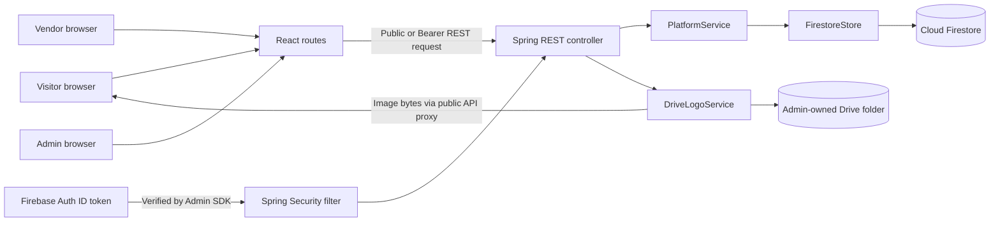
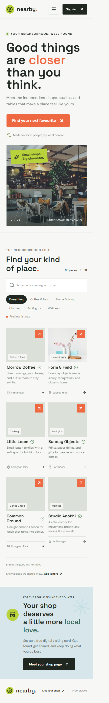
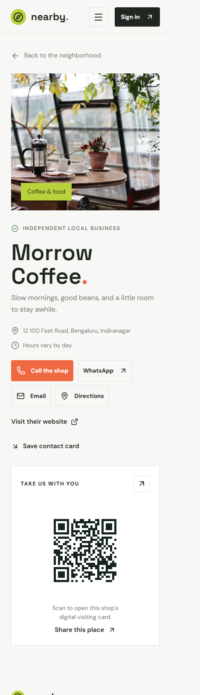

# Maintainer Guide

Use this guide to find the owning file before changing a feature. The application is split into a Vite/React frontend and a Spring Boot API. The browser never reads or writes Firestore directly; all business data goes through `/api/v1`.

## Start Here

- Local install, run, environment variables, admin bootstrap, and deploy: [README](../README.md)
- Complete REST route list and response conventions: [API contract](api-contract.md)
- Firestore collections and fields: [Firestore model](firestore-model.md)
- Firebase/Drive/host setup: [Deployment notes](deployment.md)
- Required live integration checks: [Staged verification](staged-verification.md)

The site can run without Firebase configuration using preview shop data. That mode is for UI work only: authenticated vendor/admin workflows and live Firestore data are not available.

## Package Map

```text
.
|-- frontend/
|   |-- index.html                 Browser title, description, theme color, favicon reference
|   |-- package.json               Frontend scripts and dependencies
|   |-- vite.config.ts             Vite + Tailwind plugin and API dev proxy
|   |-- tsconfig*.json             TypeScript compiler configuration
|   |-- .env.example               Frontend variable-name template; no real secrets
|   |-- Dockerfile                 Frontend container build
|   |-- nginx.conf                 Static hosting and API proxy
|   |-- src/
|   |   |-- main.tsx               React entry point; imports global stylesheet
|   |   |-- App.tsx                Router, shared header/footer, public directory and visiting card
|   |   |-- VendorPage.tsx         Vendor registration, shop editor, catalogue, share link
|   |   |-- AdminPage.tsx          Vendor/shop review, publish, Drive logo assignment/removal
|   |   |-- api.ts                 Typed REST calls, Firebase bearer token, shared data types
|   |   |-- firebase.ts            Firebase web app + Google Auth initialization
|   |   `-- index.css              Design tokens and page styles
|   |-- public/
|   |   |-- 404.html               GitHub Pages SPA route fallback
|   |   `-- ecardmitra-card.svg    Shared e-card brand mark
|   `-- dist/                      Generated Vite output; never edit by hand
|-- backend/
|   |-- pom.xml                    Java dependencies and build plugins
|   |-- Dockerfile                 Backend container build
|   `-- src/
|       |-- main/java/com/krniket/platform/
|       |   |-- ECardMitraApplication.java   Spring Boot entry point
|       |   |-- api/                          Controllers, DTOs, exception handler
|       |   |-- service/                      Business rules and workflow decisions
|       |   |-- data/                         Firestore repository boundary
|       |   |-- security/                     Firebase token verification, HTTP security, admin bootstrap
|       |   |-- integration/                  Google Drive logo upload/download
|       |   `-- config/                       Firebase/Drive beans and OpenAPI setup
|       |-- main/resources/application.yml    Port, integration flags, CORS, multipart, docs
|       `-- test/java/.../PlatformServiceTest.java  Service rule tests with in-memory store fake
|-- .github/workflows/
|   |-- deploy-pages.yml            GitHub Pages build/deployment
|   `-- deploy-render.yml           GHCR image build and Render deploy hook
|-- .env.example                   Root Compose/backend variable-name template; no secrets
|-- compose*.yaml                  Local frontend/backend and optional integration overlays
|-- firebase.json                  Firebase Hosting output + Firestore deploy file paths
|-- firestore.rules                Deny all direct browser access
|-- firestore.indexes.json         Composite Firestore indexes
|-- docs/
|   |-- assets/                   Checked-in local UI screenshots
|   |-- maintainer-guide.md       This source/change map
|   |-- api-contract.md           REST methods, access, pagination, bodies
|   |-- firestore-model.md        Collection fields and indexes
|   |-- deployment.md             GitHub Pages, Render, Firebase, CORS, Drive setup
|   `-- staged-verification.md    Live acceptance checklist
`-- node_modules/                 Generated dependencies; frontend dependencies live in frontend/node_modules
```

## Architecture



Controller methods validate transport/body and select a service operation. `PlatformService` owns state transitions and ownership checks. `FirestoreStore` is the only Firestore access boundary. `FirebaseAuthenticationFilter` creates the principal from a verified token; request JSON never supplies the trusted UID or role. `DriveLogoService` validates and proxies administrator-assigned shop images.

## Frontend Routes And Ownership

| Browser path | Owning file | Main behavior |
| --- | --- | --- |
| `/` | `frontend/src/App.tsx` | Search/filter public shops. Uses API data when available and sample listings otherwise. |
| `/shops/:slug` | `frontend/src/App.tsx` | Public shop card, contact links, vCard download, QR/share, active products. |
| `/vendor` | `frontend/src/VendorPage.tsx` | Sign in, register profile, create/edit shop, submit review, add/remove products. |
| `/admin` | `frontend/src/AdminPage.tsx` | Claim-gated dashboard, approve/reject vendors, approve/publish shops, assign/remove logos. |

`frontend/src/App.tsx` owns the route table and the sample preview records. Put shared navigation or footer changes there. Keep vendor/admin forms and dashboards in their dedicated page modules. Keep REST details in `frontend/src/api.ts`, not in button components.

### Change Recipes

| Change | Edit these locations |
| --- | --- |
| Website title/description/browser theme | `frontend/index.html` (`<title>`, description, theme-color). |
| Header/footer brand text and e-card mark | Brand text and `wordmark` markup are in `frontend/src/App.tsx`; edit `frontend/public/ecardmitra-card.svg` to update the shared logo image. |
| Browser tab icon | `frontend/index.html` references the shared brand asset in `frontend/public/`. |
| Main colors/fonts/spacing/responsive layout | `frontend/src/index.css` CSS variables near the top, then the relevant component selectors/media query. Keep letter spacing at zero and check mobile width. |
| Home hero / local preview shop photos | Change the `img` URL in the hero markup or a sample record's `coverUrl` in `frontend/src/App.tsx`. Use a licensed/owned image URL and keep a useful `alt` description. |
| Real assigned shop logo | Do not edit the sample array or let a vendor set the URL. The admin uploads through `/admin/shops/{shopId}/logo`; Java stores a Drive ID and public API proxy URL. |
| A public shop or card UI element | `frontend/src/App.tsx`; add data to `Shop` in `frontend/src/api.ts` if the API returns a new field. |
| Category/filter option | Update `categories` in `frontend/src/App.tsx` and `frontend/src/VendorPage.tsx`; create/activate matching `categories/{categoryId}` data in Firestore for the public categories endpoint. Keep spellings identical. |
| Vendor dashboard form or catalogue interaction | `frontend/src/VendorPage.tsx`; add/change request DTO and service support in Java too. |
| Admin review/upload control | `frontend/src/AdminPage.tsx`; keep its REST path aligned with `PlatformController`. |
| Frontend endpoint, auth header, JSON/multipart behavior | `frontend/src/api.ts`. It adds a Firebase ID token when signed in and intentionally leaves `FormData` content-type unset so the browser adds its boundary. |
| Add/change a REST endpoint | DTO in `api/ApiModels.java` if needed -> mapping/authorization in `api/PlatformController.java` -> business rule in `service/PlatformService.java` -> Firestore operation in `data/FirestoreStore.java`; add a test and update `docs/api-contract.md`. |
| Change a Firestore field/collection/query | `PlatformService.java` and/or `FirestoreStore.java`, `docs/firestore-model.md`, and indexes in `firestore.indexes.json`; use Admin SDK only. |
| Change a role or authorization rule | `security/FirebaseAuthenticationFilter.java`, `security/SecurityConfiguration.java`, and `@PreAuthorize` on controller methods; update security tests/checklist. Never accept a role from the browser. |
| Change shop approval/publication | `PlatformService.java` state checks and admin endpoints in `PlatformController.java`; update the workflow section/checklist and test prohibited transitions. |
| Change Drive logo handling/limits/proxy | `integration/DriveLogoService.java`, admin/public controller routes, shop logo fields in Firestore docs, and [deployment notes](deployment.md). Never give vendors logo fields in their patch DTO. |
| Change API host, CORS, Firebase/Drive flags, upload size | Environment variable in `.env.example` + `backend/src/main/resources/application.yml` + deployment guide. Set real secrets only in local ignored `.env.local` (web config) or the backend host secret store. |
| Add frontend dependency or command | `frontend/package.json`, then run `npm install` from `frontend/` so `frontend/package-lock.json` stays in sync. |

**Branding:** “e-CardMitra” is live text in the header/footer. The e-card mark is the shared image asset at `frontend/public/ecardmitra-card.svg`, used in the header, footer, and browser tab.

The shop-card `coverUrl` is an optional public image field. When it is missing but a logo is uploaded by the shop owner or assigned by an admin, `PlatformService.publicFields()` maps that `logoUrl` to `coverUrl` for card display. The shop document keeps one `logoUrl` string and a private Drive `logoFileId`; it does not store a URL array or a public Drive link. Both vendor and admin logo upload require `DRIVE_ENABLED=true`, a configured `DRIVE_LOGO_FOLDER_ID`, and backend credentials with access to that folder. Sample `coverUrl` values are only local preview content; vendor product-image upload is not available.

## REST Change Path

1. Add or update a request/response record and Bean Validation annotations in `backend/src/main/java/com/krniket/platform/api/ApiModels.java`.
2. Add the endpoint in `PlatformController.java`, choose the right `@PreAuthorize` role, and return the appropriate status code.
3. Implement ownership, validation, and workflow/state transitions in `PlatformService.java`.
4. Add Firestore reads/writes to `FirestoreStore.java`; do not instantiate Firestore clients in controllers.
5. Call it from `frontend/src/api.ts`, then connect the helper to the relevant React page.
6. Update `docs/api-contract.md`, `docs/firestore-model.md` if the schema changes, and deployment/index notes where needed.
7. Add a focused service/controller test and run the frontend checks from `frontend/`, plus `mvn -f backend/pom.xml test` from the repository root.

For the current complete method/path/access/status list, see [API contract](api-contract.md). Springdoc generates the live OpenAPI document at `/v3/api-docs` and Swagger UI at `/swagger-ui.html` when the backend is configured and running.

## Workflow And Data Notes

- Firebase Authentication identifies the person. The backend verifies the Firebase ID token and derives the UID and `superAdmin` claim from that verified token.
- `POST /api/v1/users/register` is idempotent. New vendor profiles begin pending; the admin custom claim is provisioned only by `SuperAdminBootstrap`.
- Vendors may edit their shop and products only through `/shops/me...` routes. Backend lookup binds every product operation to the caller's owned shop.
- Shop submission, vendor approval, shop approval, and publication are separate states. Public APIs return only shops where both `approved` and `published` are true. Publish also checks the owner's approval and suspension state.
- Direct browser Firestore access is denied in `firestore.rules`. The service account/Admin SDK bypasses those rules, so controller role checks and service ownership checks are security boundaries.
- Shop logo bytes are uploaded into the configured Drive folder. The Firestore shop document retains `logoFileId` and a stable API URL. Anonymous visitors receive bytes from `/api/v1/public/shops/{slug}/logo`; the Drive file itself need not have a public share link.
- Product image URLs are fields only; product-image upload/storage is not implemented. Do not document it as a working upload flow.
- Firestore search currently reads a bounded result set and filters text in the service. For a large directory, add a real search index and cursor pagination before increasing traffic.

## Environment And Debugging

| Variable | Used by | Purpose |
| --- | --- | --- |
| `VITE_API_BASE_URL` | Vite/browser | Root URL for the Spring API (default `http://localhost:8080`). |
| `VITE_BASE_PATH` | Vite/browser | Deployment path prefix; GitHub Pages uses `/eVisitingCard/`, Docker/local development use `/`. |
| `VITE_FIREBASE_API_KEY`, `VITE_FIREBASE_AUTH_DOMAIN`, `VITE_FIREBASE_PROJECT_ID`, `VITE_FIREBASE_APP_ID` | Browser Firebase Auth | Public Firebase web-app configuration; all four must be set to initialize Auth. |
| `PORT` | Spring Boot | API port, default `8080`. |
| `FIREBASE_ENABLED` | Spring config | Creates Firebase Admin, Auth, and Firestore beans when `true`. |
| `GOOGLE_CLOUD_PROJECT` | Spring Firebase Admin | Sets the Firebase project used by the backend. |
| `GOOGLE_APPLICATION_CREDENTIALS` | Google SDK ADC | Server-side service-account path locally; prefer workload identity/secret manager in production. |
| `DRIVE_ENABLED`, `GOOGLE_DRIVE_CREDENTIALS`, `DRIVE_LOGO_FOLDER_ID` | Spring Drive integration | Enables Drive client, loads the authorized administrator's user ADC, and selects the logo folder. |
| `CORS_ALLOWED_ORIGINS` | Spring Security | Comma-separated exact frontend origins; no wildcard by default. |
| `PUBLIC_BASE_URL` | Drive logo service | Public HTTPS API origin used when saving proxy logo URLs. |

Quick checks:

```powershell
Set-Location frontend
npm run build
npm run lint
Set-Location ..
mvn -f backend/pom.xml test
```

- Browser still shows preview listings: expected when the API is unavailable or returns an empty page. Check browser Network, `VITE_API_BASE_URL`, API health, and Firestore credentials.
- Browser says sign-in config is missing: check all four `VITE_FIREBASE_*` values and restart Vite after changing `.env.local`.
- `401`: missing/expired/revoked ID token or Firebase Admin verification failure. Sign out/in and check backend credentials/project.
- `403`: valid identity but wrong role/claim. Verify controller `@PreAuthorize`, Firebase custom claim, then refresh the user's ID token.
- `404` for vendor shop: create a shop first; `/shops/me` is ownership-resolved, not an ID lookup.
- `409` on publish: shop approval or vendor approval/active status has not passed. Inspect Firestore server-managed state.
- `503` from a data route: Firebase is disabled or Firestore/Drive is unavailable. Health does not prove Firestore/Drive connectivity.
- Error response `traceId`: search backend logs for that ID. Unexpected exception details are intentionally not sent to the browser.
- Logo route fails for a visitor: check assigned `logoFileId`, Drive API enablement, service identity folder access, MIME/content, `PUBLIC_BASE_URL`, and anonymous proxy response. Do not switch to an unverified Drive share URL.

## Visual References

These are local preview screenshots with sample shops. They are useful for locating page areas, not proof of connected backend data or a production brand asset library.





Regenerate UI captures from the running frontend after deliberate UI changes, verify the viewport in the browser, and replace the corresponding file in `docs/assets/`. Keep screenshots free of real vendor contact data, tokens, and account details.

## Local Verification Status

Source build/lint, backend unit tests, and browser layout/filter/QR/contact smoke checks have been run for this workspace. Firebase project authentication, real Firestore rules/data, Drive assignment/delivery, deployed CORS, end-to-end authorization, and production publication have not been exercised without project credentials. Track those in [staged verification](staged-verification.md); do not mark an external integration complete from a build alone.
